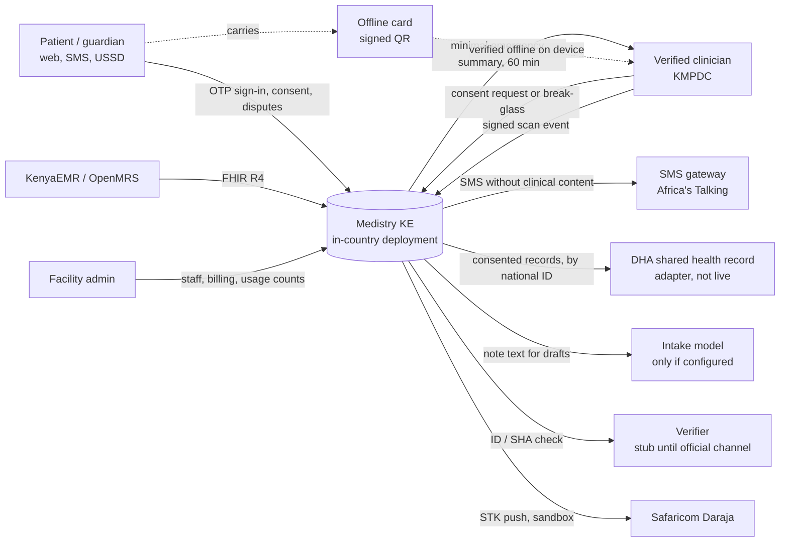

# Data Protection Impact Assessment (template): Kenya

> **Status: DRAFT TEMPLATE, pre-filled from the system design. Not a completed DPIA and not legal advice.**
> Medistry is *designed to support* the obligations described below; no claim of legal compliance is made.
> Every legal conclusion is marked **TO BE CONFIRMED BY COUNSEL**. The open actions are in
> [REGULATOR_ACTIONS.md](REGULATOR_ACTIONS.md).

| Field | Value |
|---|---|
| Deployment | One deployment per country: `DEPLOYMENT_COUNTRY=KE` (see [DEPLOYMENT.md](../DEPLOYMENT.md)) |
| Law in scope | Data Protection Act, 2019; regulator: Office of the Data Protection Commissioner (ODPC). Whether the Digital Health Act, 2023 and its regulations apply, and how: **TO BE CONFIRMED BY COUNSEL** |
| Controller / processor roles | Medistry operator, facilities, and processors listed below. Which party is controller for which activity: **TO BE CONFIRMED BY COUNSEL** |
| DPIA owner | _(name, role)_ |
| Data protection officer | _(name; whether a DPO is required: TO BE CONFIRMED BY COUNSEL)_ |
| Version and date | _(fill in)_ |
| Approved by | _(name, role, date)_ |

## 1. What the system does

The same system as in Nigeria (see [DPIA_TEMPLATE_NG.md](DPIA_TEMPLATE_NG.md), section 1), deployed separately in
Kenya with its own database, keys and logs. Kenyan specifics: clinicians are checked against KMPDC (manual, the
online lookup is not confirmed), national ID and SHA number verification are stubs until an official channel is
agreed, facility billing uses M-Pesa (Daraja sandbox only in this build), and the national exchange adapter targets
the Digital Health Agency's shared health record (not live).

## 2. Data categories

| Category | Examples | Where in the code | Protection at rest |
|---|---|---|---|
| Identity | name, date of birth, gender | `src/lib/patient/profile.ts` | AES-256-GCM field encryption, versioned keys (`src/lib/crypto/keyProvider.ts`) |
| Contact | phone (also used for M-Pesa prompts to facility admins, never patients), email, emergency contacts | `src/lib/auth/accounts.ts`, `src/lib/patient/profile.ts` | encrypted; keyed-hash lookups |
| National identifiers | national ID, SHA number | `src/lib/identity/identityStore.ts`, `src/lib/identity/IdentityVerifier.ts` | encrypted plus a blind index (`IDENTITY_INDEX_KEY`); never logged |
| Health (sensitive personal data: TO BE CONFIRMED BY COUNSEL how each item is classified) | allergies, conditions, medications, encounters, lab results, blood group, genotype, DNR | `src/lib/clinical/store.ts` | encrypted; versioned; never hard-deleted |
| Emergency card | core fields and patient opt-in items, signed but **not encrypted** | `src/lib/emergency/offlineCard.ts` | held by the patient; opt-in per item |
| Access and audit | who opened which record, when, why | `src/lib/audit/hashChain.ts` | SHA-256 hash chain verified at start-up |
| Offline scan events | clinician, device, reason, time; `clinicianCountry` and `cardCountry` for cross-border scans | `src/lib/emergency/offlineScans.ts` | no card contents uploaded |
| Staff | KMPDC licence number and document, facility contacts, accreditation documents | `src/lib/auth/staff.ts`, `src/lib/facilities/onboarding.ts` | malware-scanned, encrypted |
| AI intake inputs | photo or voice note, draft fields | `src/lib/intake/intakeService.ts` | encrypted; drafts until signed |
| Messages and USSD | SMS text (no clinical content), USSD sessions with a PIN | `src/lib/i18n/translations.ts`, `src/lib/ussd/ussdService.ts` | codes and PINs stored only as hashes |
| Billing (facilities only) | plan, status, M-Pesa request id | `src/lib/billing/MpesaDarajaProvider.ts` | no payment credentials held |

Children: as in Nigeria (`src/lib/auth/proxies.ts`); Kenyan rules on children's data and the age of majority:
**TO BE CONFIRMED BY COUNSEL**.

## 3. Purposes and lawful bases

| Purpose | Candidate lawful basis | Status |
|---|---|---|
| Keeping and sharing the record with clinicians the patient approves | consent; provision of health care | **TO BE CONFIRMED BY COUNSEL** |
| Emergency access without consent (break-glass, offline card) | vital interests; provision of health care | **TO BE CONFIRMED BY COUNSEL** |
| Audit, disputes, anomaly review | legal obligation; legitimate interests | **TO BE CONFIRMED BY COUNSEL** |
| Access notifications | as for the access | **TO BE CONFIRMED BY COUNSEL** |
| EMR imports (e.g. KenyaEMR through the OpenMRS connector, `src/lib/integrations/emr/OpenMrsConnector.ts`) | provision of health care; the facility's basis | **TO BE CONFIRMED BY COUNSEL** |
| Pushing records to, and reading summaries from, the national shared health record | patient consent in Medistry; whether national rules require, permit or replace it | **TO BE CONFIRMED BY COUNSEL** |
| National ID / SHA verification | official channel and permitted purpose | **TO BE CONFIRMED BY COUNSEL** (stub today) |
| Clinician and facility verification | professional regulation; legitimate interests | **TO BE CONFIRMED BY COUNSEL** |
| Facility billing | contract with the facility | **TO BE CONFIRMED BY COUNSEL** |

## 4. Data flows

Cross-border: a Kenyan clinician may scan a Nigerian patient's card; the card data travels with the patient and only
a scan event is uploaded. Whether that scan event is a regulated transfer, and which law governs it:
**TO BE CONFIRMED BY COUNSEL**. Processor hosting locations: **TO BE CONFIRMED** (see
[RECORDS_OF_PROCESSING.md](RECORDS_OF_PROCESSING.md)).

## 5. Retention

As in Nigeria: configurable `RETENTION_*` settings with no defaults, a report-only job
(`src/lib/ops/retention.ts`, GET `/api/admin/retention-report`), nothing deleted automatically, clinical records never
hard-deleted. Kenyan periods for medical records and other categories: **TO BE CONFIRMED BY COUNSEL**.

## 6. Risks and mitigations

The risk register R1 to R11 in [DPIA_TEMPLATE_NG.md](DPIA_TEMPLATE_NG.md#6-risks-and-mitigations) applies unchanged
(same code). Kenyan additions:

| # | Risk to individuals | Mitigation (code) | Verified by | Residual risk |
|---|---|---|---|---|
| K1 | Unverified clinicians (KMPDC lookup not confirmed) | registration is PENDING until a facility admin approves; PENDING clinicians cannot break glass or read records (`src/lib/auth/staff.ts`) | `tests/phase12-auth.test.ts` | manual verification can be wrong |
| K2 | USSD access by someone holding the phone | caller number must match and a 4-digit PIN is required; lockout (`src/lib/ussd/ussdService.ts`) | `tests/phase13-sms-ussd.test.ts` | a person with the phone and PIN |
| K3 | Cross-border scan events | flagged for review by the audit agent (`SCAN_OUTSIDE_COUNTRY`, `src/lib/audit/anomalyAgent.ts`); both countries recorded on the event | `tests/phase19-anomaly.test.ts` | legal position open |
| K4 | Data leaving Kenya | one deployment per country; in-country hosting required, not yet set up | n/a | **open** |

## 7. Consultation and sign-off

| Who | Consulted on | Date | Outcome |
|---|---|---|---|
| Data protection officer | | | |
| Counsel | lawful bases, roles, transfers, retention, Digital Health Act applicability | | |
| Clinical safety officer | see [CLINICAL_SAFETY_CASE.md](../clinical/CLINICAL_SAFETY_CASE.md) | | |
| ODPC (if consultation is required: TO BE CONFIRMED BY COUNSEL) | | | |

Decision: _(proceed / proceed with conditions / do not proceed)_ — signed: ____________________ date: __________
