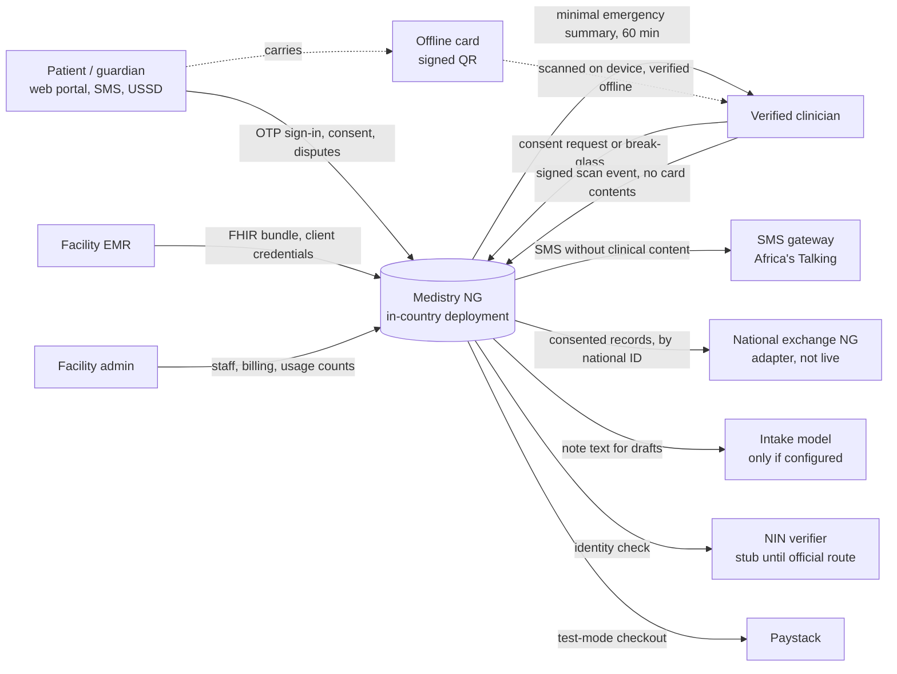

# Data Protection Impact Assessment (template): Nigeria

> **Status: DRAFT TEMPLATE, pre-filled from the system design. Not a completed DPIA and not legal advice.**
> Medistry is *designed to support* the obligations described below; no claim of legal compliance is made.
> Every legal conclusion is marked **TO BE CONFIRMED BY COUNSEL**. The open actions are in
> [REGULATOR_ACTIONS.md](REGULATOR_ACTIONS.md).

| Field | Value |
|---|---|
| Deployment | One deployment per country: `DEPLOYMENT_COUNTRY=NG` (see [DEPLOYMENT.md](../DEPLOYMENT.md)) |
| Law in scope | Nigeria Data Protection Act 2023 (NDPA); regulator: Nigeria Data Protection Commission (NDPC). Other health, records and professional rules that apply: TO BE CONFIRMED BY COUNSEL |
| Controller / processor roles | Medistry operator, facilities, and processors listed below. Which party is controller for which activity: **TO BE CONFIRMED BY COUNSEL** |
| DPIA owner | _(name, role)_ |
| Data protection officer | _(name; whether a DPO is required: TO BE CONFIRMED BY COUNSEL)_ |
| Version and date | _(fill in)_ |
| Approved by | _(name, role, date)_ |

## 1. What the system does

Medistry lets a patient carry their medical record between facilities, and lets a verified clinician open a
minimal emergency summary when the patient cannot consent ("break-glass"), with every access recorded in a
tamper-evident audit chain and the patient notified. Patients also hold an offline emergency card (a signed QR
code). Facilities import records from their EMR, clinicians can turn paper or voice notes into draft records that a
doctor signs, and the record can be shared with the national exchange if the patient turns that on.

## 2. Data categories

| Category | Examples | Where in the code | Protection at rest |
|---|---|---|---|
| Identity | name, date of birth, gender | `src/lib/patient/profile.ts` | AES-256-GCM field encryption (`FIELD_ENCRYPTION_KEY`, versioned keys: `src/lib/crypto/keyProvider.ts`) |
| Contact | phone, email, emergency contacts | `src/lib/auth/accounts.ts`, `src/lib/patient/profile.ts` | encrypted; phone and email lookups use keyed hashes |
| National identifiers | NIN | `src/lib/identity/identityStore.ts` | encrypted plus a blind index under a separate key (`IDENTITY_INDEX_KEY`); never logged |
| Health (special category: TO BE CONFIRMED BY COUNSEL how the NDPA classifies each item) | allergies, conditions, medications, encounters, lab results, blood group, genotype, DNR | `src/lib/clinical/store.ts` (FHIR R4 resources, versioned, never hard-deleted) | encrypted |
| Emergency card | core fields and patient opt-in items, signed but **not encrypted** in the QR | `src/lib/emergency/offlineCard.ts`, `src/lib/emergency/cardPayload.ts` | the card is held by the patient; opt-in per item |
| Access and audit | who opened which record, when, why | `src/lib/audit/hashChain.ts`, `src/lib/audit/accessLogManager.ts` | SHA-256 hash chain; the server refuses to start if it does not verify |
| Offline scan events | clinician, device, reason, time, card version | `src/lib/emergency/offlineScans.ts` | no card contents are uploaded |
| Staff | clinician licence number and document, facility admin contact, accreditation documents | `src/lib/auth/staff.ts`, `src/lib/clinical/fileUpload.ts`, `src/lib/facilities/onboarding.ts` | documents malware-scanned (`src/lib/clinical/virusScanners.ts`) and encrypted |
| AI intake inputs | photo or voice note of a clinical note, draft fields | `src/lib/intake/intakeService.ts` | encrypted; drafts invisible until a doctor signs |
| Messages | SMS and email text (no clinical content in SMS templates) | `src/lib/i18n/translations.ts`, `src/lib/notifications/dispatcher.ts` | one-time codes stored only as a hash |
| Billing (facilities, not patients) | plan, status, provider reference | `src/lib/billing/billingService.ts` | no card or bank details are held by Medistry |

Children: guardians can manage a minor's record; control ends at the 18th birthday (`src/lib/auth/proxies.ts`). The
age of majority and any additional rules for children's data: **TO BE CONFIRMED BY COUNSEL**.

## 3. Purposes and lawful bases

| Purpose | Candidate lawful basis | Status |
|---|---|---|
| Keeping the patient's record and sharing it with clinicians the patient approves | consent; provision of health care | **TO BE CONFIRMED BY COUNSEL** |
| Emergency access when the patient cannot consent (break-glass, offline card) | vital interests; provision of health care | **TO BE CONFIRMED BY COUNSEL** |
| Audit log, dispute handling, anomaly review | legal obligation; legitimate interests | **TO BE CONFIRMED BY COUNSEL** |
| Notifying the patient of access (SMS, email, push) | as for the access itself | **TO BE CONFIRMED BY COUNSEL** |
| Records from facility EMRs (FHIR import) | provision of health care; facility's own basis | **TO BE CONFIRMED BY COUNSEL** |
| Sharing with the national exchange (only after the patient turns it on) | consent; any national rule that requires or replaces it | **TO BE CONFIRMED BY COUNSEL** |
| National identifier verification (NIN) | consent and the verification partner's permitted purpose | **TO BE CONFIRMED BY COUNSEL** (the verifier is a stub until an official route exists) |
| Clinician and facility verification | legitimate interests; professional regulation | **TO BE CONFIRMED BY COUNSEL** |
| Facility billing | contract with the facility | **TO BE CONFIRMED BY COUNSEL** |

## 4. Data flows

Notes: no server-to-server transfer between country deployments exists. Where each external processor hosts the
data it receives, and whether any of it leaves Nigeria: **TO BE CONFIRMED** per processor (see
[RECORDS_OF_PROCESSING.md](RECORDS_OF_PROCESSING.md)).

## 5. Retention

Retention periods are not set: each is a configurable `RETENTION_*` setting with no default, reported by the
report-only job (`src/lib/ops/retention.ts`, `scripts/retention-report.ts`, GET `/api/admin/retention-report`).
Nothing is deleted automatically. Clinical records and their versions are never hard-deleted. The periods for each
category: **TO BE CONFIRMED BY COUNSEL**.

## 6. Risks and mitigations

| # | Risk to individuals | Mitigation (code) | Verified by | Residual risk |
|---|---|---|---|---|
| R1 | Unauthorised access to records | consent per clinician and scope; deny-by-default policy (`src/lib/policy/enforcer.ts`); staff and admin tokens refused on patient routes (`src/lib/site/portalApi.ts`) | `tests/phase12-auth.test.ts`, `tests/phase18-facility.test.ts` | a verified clinician with consent can misuse it; the audit trail and anomaly review deter and expose it |
| R2 | Misuse of break-glass | 60-minute read-only grant, reason required, patient notified, dispute flow, anomaly rules (`src/lib/audit/anomalyAgent.ts`) | `tests/phase6.test.ts`, `tests/phase19-anomaly.test.ts` | detection is after the fact |
| R3 | Data exposed by the offline card | core fields only by default; opt-in per item; no name or national ID in the QR | `tests/phase8-card-content.test.ts` | anyone holding the card can read it; this is the design |
| R4 | Breach of stored data | field encryption, blind index, key versions and rotation (`scripts/rotate-field-key.ts`), encrypted backups (`scripts/backup.sh`) | `tests/phase8-storage.test.ts`, `tests/phase14-hardening.test.ts` | key custody is an operational control |
| R5 | Tampering with the audit log | hash chain; start-up refuses a broken chain (`src/lib/runtime.ts`) | `tests/phase8-storage.test.ts` | an attacker with database and code access could rebuild the chain; off-site backups help |
| R6 | Wrong patient matched or merged | national-ID blind index; duplicates queued for a human; merges reversible (`src/lib/identity/mpi.ts`) | `tests/phase16-identity.test.ts` | depends on reviewers |
| R7 | Model errors in AI drafts | values must match a span of the source; unknown fields dropped; nothing visible until a doctor signs (`src/lib/intake/intakeService.ts`) | `tests/phase15-intake.test.ts` | a doctor may sign without reading |
| R8 | Clinical content leaking through SMS | templates carry no clinical fields (`src/lib/i18n/translations.ts`) | `tests/phase13-sms-ussd.test.ts` | the SMS still reveals that Medistry is used |
| R9 | Facility staff reading PHI through admin tools | facility admins have no PHI access; usage dashboard is counts only (`src/lib/facilities/usage.ts`) | `tests/phase18-facility.test.ts` | none known |
| R10 | Data leaving Nigeria | one deployment per country; in-country hosting is required but not yet set up | n/a | **open**: in-country hosting and processor locations |
| R11 | Logs containing personal data | structured logger redacts phones, emails, codes, long digit runs (`src/lib/ops/logger.ts`) | `tests/phase14-hardening.test.ts` | free text could still slip through |

## 7. Consultation and sign-off

| Who | Consulted on | Date | Outcome |
|---|---|---|---|
| Data protection officer | | | |
| Counsel | lawful bases, roles, transfers, retention | | |
| Clinical safety officer | see [CLINICAL_SAFETY_CASE.md](../clinical/CLINICAL_SAFETY_CASE.md) | | |
| Patients' representatives | | | |
| NDPC (if prior consultation is required: TO BE CONFIRMED BY COUNSEL) | | | |

Decision: _(proceed / proceed with conditions / do not proceed)_ — signed: ____________________ date: __________
