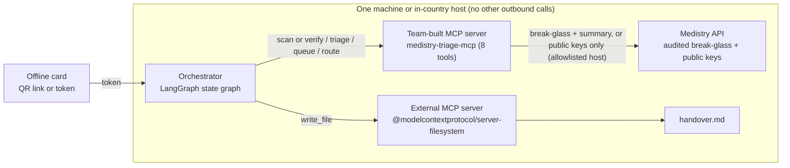

# Medistry Triage MCP

MCP server for the **Agentic Africa Challenge** (theme: **healthcare triage**). It connects Medistry's
audited emergency break-glass record to SATS/TEWS triage, queue management and in-country referral routing.

> Decision support only. A clinician makes every clinical decision. All data is **synthetic**.
> The TEWS bands and discriminators were written from the published SATS design and must be validated
> against the official SATS manual by a clinician before any real use.

## What it does

An unconscious patient arrives with a Medistry emergency code or an offline Medistry card. The scan step either
calls `get_emergency_summary` (an audited, patient-notified break-glass in Medistry) or, for an offline card,
`verify_offline_card` (the card's ES256 signature is checked locally; only Medistry's public keys are fetched).
The graph then scores triage with SATS TEWS, queues the patient under a pseudonymous reference, recommends an
in-country referral, and writes a handover note through an external MCP server.



Graph: `scan_step -> triage_step -> route_step -> handover_step`. The scan step picks the tool from the input:
an emergency code uses `get_emergency_summary`; a card token or `.../s#token` link uses `verify_offline_card`.
The handover then says `Source: offline Medistry card v{n}, signature verified` or `NOT VERIFIED` (and, if not
verified, that the card data was not used). Any MCP client (for example Claude Desktop) can also use the server directly.

## Tools (team-built server)

| Tool | Purpose |
|---|---|
| `get_emergency_summary` | Starts a real, audited break-glass session in Medistry and returns a **minimised** summary: blood group, genotype, allergies, conditions, medications, DNR flag, alerts. No name, contacts, photo or code. Requires `confirmBreakGlass: true`. |
| `score_triage_priority` | **Scores priority**: TEWS plus discriminators to RED / ORANGE / YELLOW / GREEN, target time, breakdown, reasons |
| `flag_deterioration` | **Flags deterioration** across 2-12 observation sets: rising TEWS, jumps, threshold crossings, AVPU drop |
| `route_referral` | **Routes referrals**: capability, open ED, ICU bed, level of care, distance, queue length (synthetic facilities) |
| `queue_add_patient`, `queue_get`, `queue_call_next` | Priority queue per facility, with wait times and overdue flags |
| `verify_offline_card` | Verifies an offline Medistry card (token or `${APP_URL}/s#token` link) **locally** with node:crypto, using public keys fetched only from `MEDISTRY_URL` (allowlisted host) and cached in memory. Returns a **minimised** view: blood group, genotype, allergies, DNR, conditions, medications, recent diagnosis, card version, `verified`, `expired`. Never the emergency contact or the patient id. If `verified` is false, no medical data is returned. Does not create a Medistry audit event; record clinical scans in the Medistry scanner. |

## Challenge requirements

- [x] Team-owned MCP server with 3 or more tools, including score priority, flag deterioration and route referrals
- [x] Integrates an MCP server **not built by the team**: `@modelcontextprotocol/server-filesystem` (writes the handover)
- [x] Open-source orchestration framework: **LangGraph**
- [x] Patient data stays in-country: the server contacts only `MEDISTRY_URL`, and refuses any host not in `MEDISTRY_ALLOWED_HOSTS` (default `localhost`). Queues are in process memory. Output is minimised and pseudonymous.
- [x] Public code repository, architecture (this file) and evaluation tasks (`eval/tasks.json`, `test/`)
- [ ] Demo video: record `npm run demo`, then an MCP client calling the tools
- [ ] Confirm the challenge period dates and licence rules against the official page

## Run

```bash
# terminal 1: Medistry (repo root), demo mode on by default
npm start

# terminal 2
cd mcp && npm install
npm test        # 43 tests: unit, evaluation tasks over stdio MCP, Medistry integration, offline cards, agent loop (mocked LLM), minimiser
npm run demo    # LangGraph scenario with the demo emergency code, writes output/handover.md
node src/orchestrator.js "http://localhost:3000/s#<card token>"   # same scenario from an offline card (or set MEDISTRY_CARD)
npm run server  # MCP server on stdio for any MCP client
```

### LLM agent (Gemini)

`src/agent.js` lets a model choose and call the tools: it starts `src/server.js` over stdio, lists the tools,
converts their JSON Schemas to Gemini function declarations and runs a tool-calling loop (at most 8 model
turns), printing each step and the final answer. The model call sits behind `src/llm/gemini.js`
(`generate({ system, messages, tools }) -> { text, toolCalls }`), so another provider can be added later.
The key and model are read from the environment only; there is no default model.

```powershell
cd mcp
npm install
$env:GEMINI_API_KEY="<your key>"   # never commit it or paste it into logs
$env:GEMINI_MODEL="<gemini model id>"
npm run agent                         # default synthetic chest-pain task
npm run agent -- "<task text>"        # your own task
```

**Data protection.** Before anything is sent to the model, `src/minimise.js` drops names, contacts, ids and
free-text notes, and replaces card tokens, emergency codes and patient references with placeholders such as
`[CARD_1]` or `[REF_1]`. The agent maps placeholders back to the real values locally before calling a tool, so
the model can direct the tools without seeing the values. Real patient data must not be sent to a foreign-hosted
LLM without a lawful basis; production should use an in-country or self-hosted model. Name detection in free
text is heuristic, so keep names out of task text.

The system prompt forbids invented clinical values, and `get_emergency_summary` is blocked in code unless
the task says the patient is unconscious, contains the emergency code, and the call sets
`confirmBreakGlass: true`. The MCP server child process does not receive the `GEMINI_*` variables.
Outputs are decision support only and must be validated by a clinician. `test/agent.test.js` tests the
loop with a mocked Gemini client (no network, no key).

Claude Desktop:

```json
{ "mcpServers": { "medistry-triage": {
  "command": "node", "args": ["/abs/path/mcp/src/server.js"],
  "env": { "MEDISTRY_URL": "http://localhost:3000", "MEDISTRY_DEMO": "1" } } } }
```

| Variable | Purpose |
|---|---|
| `MEDISTRY_URL` | Medistry base URL (default `http://localhost:3000`) |
| `MEDISTRY_ALLOWED_HOSTS` | Comma-separated hosts patient data may be requested from (default `localhost,127.0.0.1`) |
| `MEDISTRY_CLINICIAN_TOKEN` or `MEDISTRY_CLINICIAN_ID` + `MEDISTRY_TOTP` | Clinician credentials. The token lasts `SESSION_TIMEOUT_MINUTES` (15) on the Medistry side. |
| `MEDISTRY_DEMO=1` | Demo servers only: picks a seeded clinician and reads the demo authenticator code |
| `GEMINI_API_KEY`, `GEMINI_MODEL` | Agent only (`npm run agent`). Both required; the agent exits if either is unset. |

## Evaluation

`eval/tasks.json` has 12 tasks. Ten are single tool calls run through the MCP protocol (`test/eval.test.js`):
routine vs discriminator upgrade vs emergency override, shock physiology, paediatric rejection, deterioration
true-positive and true-negative, ICU-aware routing, closed-ED exclusion, and refusal to break glass without
explicit confirmation. Two are full offline-card flows run against a real Medistry (`test/offline-card.test.js`):
T11, a valid card whose verified data drives triage, a haematology referral and a "signature verified" handover;
and T12, a tampered card whose data is refused, with a "NOT VERIFIED ... Card data was not used" handover.
`test/offline-card.test.js` also checks `verify_offline_card` for valid, tampered, expired, unknown-key and
wrong-alg cards, the residency guard, and that no contact, patient id or code is ever returned. `test/medistry.test.js`
boots a real Medistry and checks the summary content, data minimisation (no name, contacts, photo, DOB or
code in the output), that every call grows a valid audit chain, unknown-code handling, the residency guard
and sign-in failure reporting.
Next step for real validation: run against a de-identified retrospective triage dataset and measure
under-triage (the safety-critical error) against nurse-assigned categories.

## Known limits

- Adults, age 12 and up, only.
- Facilities are synthetic; a real deployment needs a live national registry and bed feeds.
- Queue tools have no authentication or audit log yet. Run the server only where access is already controlled.
- Medistry's encounter history is placeholder data in this build, so it is deliberately not returned.
- `get_emergency_summary` is a genuine break-glass: it notifies the patient and is logged. Do not call it casually in demos against shared data.
- The public Medistry demo is hosted outside Nigeria; the data is synthetic. A real deployment needs an in-country region.
